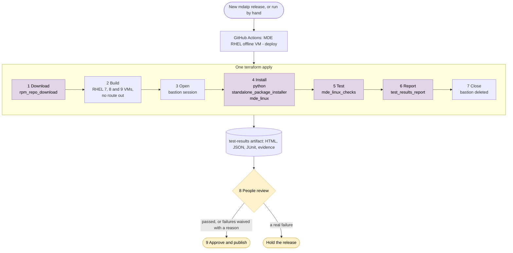
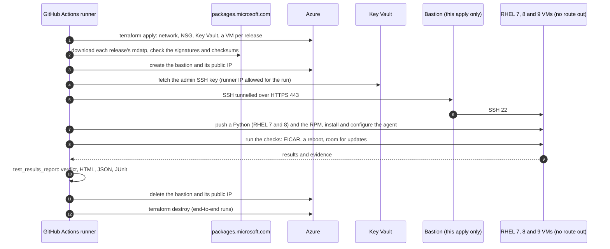

  <a href="https://libredevops.org">
    <picture>
      <source media="(prefers-color-scheme: dark)" srcset="https://libredevops.org/assets/libre-devops-white.png">
      
    </picture>
  </a>

# Azure Orchestration

End-to-end builds that put the Libre DevOps Terraform modules, the `terraform-azure` action and the
Ansible roles together, from a GitHub-hosted runner, against VMs nobody can reach from outside: one
Terraform apply builds the VMs and configures them through an Azure Bastion that exists only for
that apply.

---

## MDE Linux VM

[`stacks/mde-linux`](./stacks/mde-linux) builds an Ubuntu 24.04 VM and installs Microsoft Defender
for Endpoint on it with [`libre_devops.mde_linux`](https://github.com/libre-devops/ansible-role-mde-linux),
run from Terraform by [terraform-ansible-role](https://github.com/libre-devops/terraform-ansible-role)
after [`libre_devops.python`](https://github.com/libre-devops/ansible-role-python). Then
[`libre_devops.mde_linux_checks`](https://github.com/libre-devops/ansible-role-mde-linux-checks) tests
the agent (installation, stability, real-time protection and the EICAR test, the cloud connection,
a reboot) and [`libre_devops.test_results_report`](https://github.com/libre-devops/ansible-role-test-results-report)
writes the report, failing the apply if a check that counts failed. The VM has no public IP and the
runner has no network path to it (no VPN, firewall or private endpoint).

The report is in the job summary, and the deploy workflow uploads it with the evidence as the
`test-results-<workspace>` artifact: `test-results.html` for people (one self-contained page:
open it first), `test-results.json` for pipelines, `test-results.xml` (JUnit) for test views. A local apply leaves it in
`stacks/mde-linux/.terraform/test-results/<plan time>/` (the `test_results_directory` output).

### How the runner reaches the VM

Ansible runs on the GitHub-hosted runner and connects through a **bastion session** from the
[bastion-session](https://github.com/libre-devops/terraform-azurerm-bastion-session) module, which
exists only during an apply with `configure = true`. One apply does all of it:

| Step | What happens |
|---|---|
| Open | The module grants the identity running Terraform (the CI service principal) the Virtual Machine Administrator Login role on the VM, or fetches the vaulted SSH key, creates a Standard Azure Bastion with native client tunnelling and its public IP with `az`, and waits until SSH signs in through it. |
| Configure | Two terraform-ansible-role calls run through the session, chained with `depends_on`: `libre_devops.python`, then `libre_devops.mde_linux` on the `mde_linux` hosts. Their SSH connections go through the session's `ProxyCommand` and one `az network bastion tunnel` per VM. |
| Close | Once both calls have finished, the module deletes the bastion, its public IP and the role assignment, and removes the certificate or key. |
| Always | A failed role run stops the apply before the close step, so the deploy workflow then always runs the session's close script, which deletes whatever the apply left (and does nothing when the apply closed the session itself). |
| Sweep | An hourly workflow closes a session a hard-cancelled run left behind. It runs the same close script, only when it finds something the session created, and never under a run that is using it. |

The bastion is created and deleted with `az` from inside the apply rather than as a Terraform
resource, because Terraform cannot create and delete the same resource in one apply. That is what
the old pattern of two applies (open the window, run Ansible, apply again to close it) worked around,
and what the module replaces.

Everything billable or privileged lives only as long as the apply: the bastion and its public IP
(Standard bastions bill by the hour, unlike the free Developer SKU, which cannot tunnel), the
sign-in role, the runner's key vault firewall rule, the tunnels, and the certificate or fetched key.
What stays is what the VM needs to do its job: the VM, its NAT gateway (Defender for Endpoint talks
to its cloud continuously, and the network module's subnets have no implicit outbound access), the
network and the free `AzureBastionSubnet`. An apply with `configure = false` (the stack's default)
is an ordinary infrastructure apply and creates none of it.

### Signing in: `entra` or `key`

The deploy workflow's `ssh_auth` input (the stack's `ssh_auth` variable, passed to the session's
`auth`) picks one; both work against the same VM.

- **`entra` (default)**: [Entra ID SSH](https://learn.microsoft.com/entra/identity/devices/howto-vm-sign-in-azure-ad-linux)
  through the [vm-entra-login](https://github.com/libre-devops/terraform-azurerm-vm-entra-login)
  module. The runner's identity gets an OpenSSH certificate Entra ID issues on demand (`az ssh
  cert`), and the session's Virtual Machine Administrator Login role gives it the passwordless
  `sudo` the roles' `become` needs. No key exists to leak.
- **`key`**: the admin account's own key pair, which the
  [ssh-key](https://github.com/libre-devops/terraform-azurerm-ssh-key) module generates with an
  *ephemeral* `tls_private_key`, so the private key is never in the plan or state; both halves go
  into the stack's key vault write-only, and the public half becomes the VM's admin key. The
  session's target gives the user (`azureuser`) and the key's secret ID. `az network bastion tunnel`
  cannot read Key Vault itself, so the session fetches the key into a `0600` file in its working
  directory and deletes it when it closes. In the pipeline the runner is already on the vault's
  firewall for the apply (see below); anywhere else the session opens the firewall to the machine
  only for the fetch (LibreDevOpsHelpers' `Add-` and `Remove-LdoKeyVaultCurrentIpRule`). It is a
  standing credential, so it doubles as the break-glass key, rotated by bumping the module's
  `value_wo_version`.

The key vault is deny-by-default with nothing allow-listed between runs. Every Terraform step goes
through the terraform-azure action's key vault dance and also passes the runner's IP as
`key_vault_ip_rules`: on a first run there is no vault yet for the dance to open, so that is what lets
the vault and the key be created in one apply, and on every run it stops Terraform revoking its own
access mid-apply (a closing apply that removed the rule had its later secret updates refused, found on
a live run). The dance removes the rule after each step. Purge protection is off, so a destroy frees the
vault's globally unique name (Trivy reports AZU-0016 as MEDIUM, by design).

**Azure RBAC, not access policies.** The vault uses Azure RBAC, the keyvault module's default and
Microsoft's recommendation. The [role-assignment](https://github.com/libre-devops/terraform-azurerm-role-assignment)
module grants the identity running Terraform Key Vault Secrets Officer on that vault alone (a
commented example adds Key Vault Secrets User for anyone who only reads the key). The ssh-key module
writes the key in the same apply that creates the vault, and a new role assignment takes a while to
reach Key Vault's data plane, so a `time_sleep` holds the write for three minutes on the first apply.
The identity running Terraform needs rights to create role assignments (Owner, User Access
Administrator or Role Based Access Control Administrator).

### What a run costs in time

Measured on live runs of the bastion-session module's examples in UK South (Standard bastion, one
Ubuntu VM), which use the same pieces as this stack:

| Phase | Time | Notes |
|---|---|---|
| Open the session | 11 to 13 minutes | Almost all of it the bastion's creation; the sign-in role (or key fetch), the certificate and the first SSH sign-in take seconds. |
| `libre_devops.python` through the session | 8 to 9s | Nothing to change on Ubuntu. |
| `libre_devops.mde_linux` through the same session | 1m 4s | First run: repository, keys, `mdatp` installed and started. |
| Close the session | About 8 minutes | The bastion's deletion; the sign-in role goes first, in seconds. |

So the bastion bills for roughly 20 minutes per run, inside one apply, and is gone the rest of the
time. An apply with `configure = false` takes as long as the infrastructure changes and no more.

### Modules and tools

| Piece | Used for |
|---|---|
| [`libre-devops/terraform-azure`](https://github.com/libre-devops/terraform-azure) action | Every Terraform run in the pipelines: OIDC sign-in, the state storage firewall dance, tflint, trivy and the naming policies. |
| tags, rg, network, nsg, public-ip, nat-gateway modules | The resource group, a VM subnet admitting SSH from the bastion subnet only, the `AzureBastionSubnet`, and NAT egress. |
| [linux-vm](https://github.com/libre-devops/terraform-azurerm-linux-vm) | The hardened Ubuntu VM (Trusted Launch, system-assigned identity). |
| [vm-entra-login](https://github.com/libre-devops/terraform-azurerm-vm-entra-login) | Entra ID SSH on the VM (sourced from its GitHub tag until it is published on the Terraform Registry). |
| [bastion-session](https://github.com/libre-devops/terraform-azurerm-bastion-session) | The bastion, its public IP and the sign-in role for the length of the apply, and the SSH connections through them (from the Terraform Registry). |
| [terraform-ansible-role](https://github.com/libre-devops/terraform-ansible-role) | Runs each Ansible role from Terraform, through the session (sourced from its GitHub tag). |
| [keyvault](https://github.com/libre-devops/terraform-azurerm-keyvault), [role-assignment](https://github.com/libre-devops/terraform-azurerm-role-assignment), [ssh-key](https://github.com/libre-devops/terraform-azurerm-ssh-key) | The deny-by-default vault with Azure RBAC, the deployer's Key Vault Secrets Officer on it, and the ephemerally generated admin key pair. |
| [LibreDevOpsHelpers](https://www.powershellgallery.com/packages/LibreDevOpsHelpers) | The runner's egress IP, and the key vault firewall dance for the `key` sign-in outside the pipeline. |
| [`libre_devops.python`](https://galaxy.ansible.com/ui/standalone/roles/libre_devops/python/documentation/) | Python on the VM, so the next role can gather facts on any image. |
| [`libre_devops.mde_linux`](https://galaxy.ansible.com/ui/standalone/roles/libre_devops/mde_linux/documentation/) | Defender for Endpoint: repository, package, onboarding and health checks. |
| [`libre_devops.mde_linux_checks`](https://galaxy.ansible.com/ui/standalone/roles/libre_devops/mde_linux_checks/documentation/) | The release tests: 63 checks, readiness first, each with a stable id and a severity. |
| [`libre_devops.test_results_report`](https://galaxy.ansible.com/ui/standalone/roles/libre_devops/test_results_report/documentation/) | The report: thresholds, waivers and limits, as HTML, Markdown, JSON and JUnit XML. |

### Running it

**Deploy** with the `MDE Linux VM - deploy` workflow (`just deploy dev`, or `just deploy dev key` for the
vaulted key): pick the workspace and the sign-in, and tick
`destroy_after` for an end-to-end test that tears everything down at the end. **Destroy** with
`MDE Linux VM - destroy` (type the workspace name to confirm).

The pipelines use the org's existing `AZURE_CLIENT_ID`, `AZURE_TENANT_ID` and `AZURE_SUBSCRIPTION_ID`
variables and `TFSTATE_*` secrets. Onboarding is optional:

| Name | Kind | Purpose |
|---|---|---|
| `MDE_ONBOARDING_JSON` | Secret | The content of `mdatp_onboard.json` from the Defender portal (Settings > Endpoints > Onboarding > Linux Server > "Your preferred Linux configuration management tool"). The workflow writes it to a `0600` temporary file, passes its path as the stack's `mde_onboarding_file`, and deletes it afterwards. Without it, the agent installs but is not onboarded. |
| `MDE_EXPECTED_ORG_ID` | Variable | Optional: the organisation ID the role checks the device onboarded to (the stack's `mde_expected_org_id`). |

To configure from your own machine, `az login` and apply the stack with `-var=configure=true` (your
identity needs the rights in "Requirements" below). If that apply fails partway, `just close` deletes
the bastion it left; the next apply would close it too, but the bastion bills by the hour until then.

### Requirements on the runner

Linux, the Azure CLI (the session adds its `bastion` and `ssh` extensions), `ansible-core`, bash,
`jq`, `python3`, OpenSSH, and for `ssh_auth = "key"` PowerShell 7 with LibreDevOpsHelpers (installed
from PSGallery if missing). GitHub's `ubuntu-latest` image has everything but Ansible, which the
workflow installs with pipx.

The identity running Terraform needs, on top of building the stack, to create and delete the
bastion, its public IP and (for `entra`) role assignments on the VM: the CI service principal has
these already.

## MDE on RHEL with no internet

[`stacks/mde-rhel-offline`](./stacks/mde-rhel-offline) builds a VM for each RHEL release in
`rhel_releases` (7, 8 and 9 by default) that can reach nothing, and installs Defender for Endpoint
on each from its release's RPM, downloaded on the runner and pushed through a bastion session, then
tests them all, into one report. It answers the first questions about a new `mdatp` release: does
it install, protect and survive a reboot on each RHEL release, on a host with no repositories and no
route out, from nothing but the image's own packages?

The VMs have no public IP and no NAT gateway, and the network module's subnets have no default
outbound access, so they reach neither the internet nor their own Red Hat repositories (RHUI). The
only way in is SSH from the bastion subnet, while a session is open.

RHEL 7 and 8 ship Pythons (2.7 and 3.6) that current ansible-core cannot use, so
[`libre_devops.python`](https://github.com/libre-devops/ansible-role-python) first pushes them a
python-build-standalone build (the `python_archive` variable), downloaded and checked on the runner;
RHEL 9's own 3.9 is kept. RHEL 7 has yum, not dnf, which the roles handle. Its image is 7.9 (March
2023, the last). It is not on Azure's Trusted Launch list, so its VM boots without secure boot and
vTPM, and it boots from SCSI only, so it runs on a v4 size (`vm_sizes`): the v6 sizes have NVMe disk
controllers only, which Azure refuses for that image when it creates the VM.

### How a release is tested

One pipeline run does the testing; people read the report and decide. The draw.io version,
[`docs/diagrams/mde-release-testing.drawio`](./docs/diagrams/mde-release-testing.drawio), has three
pages: this concept, the Azure architecture, and one apply step by step with its timings. GitHub does
not draw `.drawio` files: open it in [draw.io](https://app.diagrams.net) or the desktop app.

Purple steps are libre_devops Ansible roles, which Terraform runs through the bastion. The same run,
as the runner sees it:

The stack builds RHEL 7, 8 and 9 in the same apply, or the releases you choose
(`just deploy-offline dev latest true 9` for RHEL 9 alone).

What the runs on 16 November 2026 found on the way:
- the RHEL 7 image boots from SCSI only, so it needs a v4 size (`vm_sizes`);
- the RHEL 7.9 and 8.10 images never synchronise their clocks with no route out, because their chrony
  tries internet NTP servers only. The stack now points chrony at the Azure host's PTP clock, as
  Microsoft recommends;
- on a fast-booting host (RHEL 8, probed 22 s after boot) the post-reboot check read real-time
  protection while it was still starting. `mde_linux_checks` 1.1.1 waits for it.

| Step | What happens |
|---|---|
| Download | [`libre_devops.rpm_repo_download`](https://github.com/libre-devops/ansible-role-rpm-repo-download) runs on the runner, which has the internet, and fetches `mdatp` for each release from `packages.microsoft.com/rhel/<release>/prod`: the workflow's `mde_version`, or the newest. It checks the repository's signature against Microsoft's keys and every checksum on the way down. |
| Open | The bastion-session module creates a Standard bastion for the apply and fetches the admin account's vaulted SSH key. Entra ID sign-in would need the VM to reach Entra ID, which it cannot. |
| Python | [`libre_devops.python`](https://github.com/libre-devops/ansible-role-python) pushes a python-build-standalone build to RHEL 7 and 8, then gathers facts with it. |
| Install | [`libre_devops.standalone_package_installer`](https://github.com/libre-devops/ansible-role-standalone-package-installer) pushes the RPM through the bastion and installs it from the file alone, with every repository disabled, after checking its signature. [`libre_devops.mde_linux`](https://github.com/libre-devops/ansible-role-mde-linux) then starts and configures the agent with `mde_linux_manage_repository: false`, and does not call the package manager, which would fail on the unreachable repositories. |
| Test | [`libre_devops.mde_linux_checks`](https://github.com/libre-devops/ansible-role-mde-linux-checks) tests the release with `mde_linux_checks_online: false`: the package's signature and dependencies, the service, real-time protection and the EICAR test file, the event provider, SELinux, room for the next update, a reboot. [`libre_devops.test_results_report`](https://github.com/libre-devops/ansible-role-test-results-report) writes the report on the runner and fails the apply if a check that counts failed. `real_time_protection`, `eicar_detection` and `service_survives_reboot` must run. |
| Close | The bastion and its public IP go once the tests have finished; the deploy workflow's always() step and an hourly sweeper catch anything a failed run leaves, as for the mde-linux stack. |

**What it proves:**
- the release's signature is Microsoft's;
- it installs with nothing but the image's own packages (`mdatp` needs `glibc`, `iptables` and
  `libacl`);
- the agent starts, protects in real time (the EICAR test file is detected and removed) and comes
  back after a reboot;
- it leaves room for the next update.

**What it cannot:** onboarding, the cloud connectivity test, security intelligence updates, scans
(mdatp scans on demand only once onboarded), or a detection reaching the portal. They all need the
Defender cloud, and the report lists them as skipped, with the reason. The
[mde-linux](#mde-linux-vm) stack, which has egress, covers the connectivity and updates.

The report is in the job summary and in the `test-results-<workspace>` artifact, with the
evidence. A local apply leaves it in `stacks/mde-rhel-offline/.terraform/test-results/<plan time>/`
(the `test_results_directory` output).

The run on RHEL 7, 8 and 9 (UK South, `mdatp` 101.26101.0000, 16 November 2026, [run 43958570981](https://github.com/libre-devops/azure-orchestration/actions/runs/43958570981)) passed, and took 43 minutes end to end:
- 20 s to download the three RPMs;
- 11m 48s to open the session;
- 7m 44s to install and test, the three VMs in parallel (RHEL 8 5m 17s, RHEL 9 6m 34s, RHEL 7 7m 44s): a Python pushed to RHEL 7 and 8, the RPM pushed through the bastion, the agent installed and the checks run, a reboot included;
- 8m 1s to close it, all in one 38m 29s apply, then 4m 26s to destroy the stack.

On each release 44 checks passed and 11 were skipped, each with its reason. EICAR was detected in 0.39 to 0.42 s. After the reboot the VMs answered in 53 s (RHEL 8) to 183 s (RHEL 7), and real-time protection was up 6.2 s later on RHEL 8, at once on the others.

Deploy with the `MDE RHEL offline VM - deploy` workflow (`just deploy-offline dev`, or
`just deploy-offline dev 101.26101.0000 true` for a version and a teardown at the end), and destroy
with `MDE RHEL offline VM - destroy`. A failed local apply leaves its bastion to
`just close mde-rhel-offline mde-rhel-offline`.

## Developing

`just validate` runs what CI runs: `terraform fmt`, `validate` and `tflint` for every stack and a
`trivy config` scan. New builds go in their own `stacks/<name>` with their own workflows: a
bastion-session module call, terraform-ansible-role calls for the roles (each with
`count = var.configure ? 1 : 0` and listed in the session's `close_after`), and an always() close
step after the apply.

## Security scan exceptions

Waivers live in [`.trivyignore.yaml`](./.trivyignore.yaml), mirrored here so the reason is auditable.

| Trivy ID | Resource | Finding | Justification |
|----------|----------|---------|---------------|
| DS-0002 | `**/.terraform/modules/*/tests/e2e/image/Containerfile` | Container image runs as root | Not this repo's code: `terraform init` downloads [terraform-ansible-role](https://github.com/libre-devops/terraform-ansible-role) into the stacks' `.terraform/modules`, and with it its end-to-end test fixture, whose SSH hosts run systemd as PID 1 (which must be root). That repo waives the same finding for the same file. |
